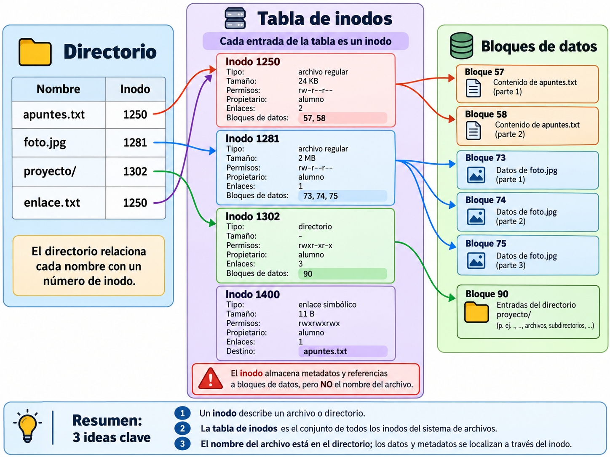
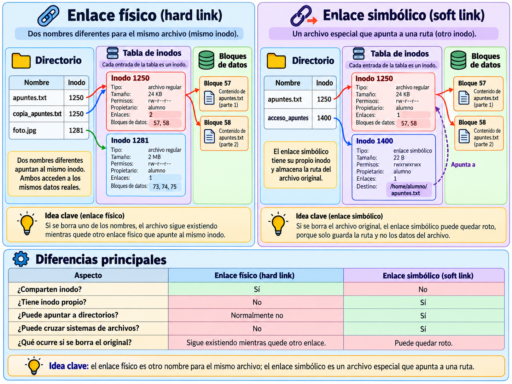

# UT6 Sistemas de archivos y procesos en Linux y Windows

## 6.3. Archivos y directorios

Los archivos y directorios son los elementos fundamentales que utilizan los sistemas de archivos para almacenar y organizar la información. Los archivos permiten guardar datos y programas, mientras que los directorios facilitan su organización y localización.

### 6.3.1. Archivos

Un **archivo o fichero** es una estructura de datos utilizada para almacenar información en un dispositivo de almacenamiento. Los archivos son elementos fundamentales para el funcionamiento del sistema operativo y de las aplicaciones, ya que permiten almacenar documentos, imágenes, vídeos, programas y otros tipos de información.

Cada archivo se identifica mediante un nombre y puede tener diferentes características dependiendo de su contenido y del sistema de archivos utilizado.

Los archivos pueden clasificarse según el formato de la información que contienen:

- **Archivos de texto:** Contienen información representada mediante caracteres. Por ejemplo, documentos de texto (`.txt`), archivos de configuración o archivos de código fuente (`.py`, `.js`).
- **Archivos binarios:** Contienen información codificada en un formato específico que generalmente necesita un programa para interpretarla. Por ejemplo, imágenes (`.jpg`, `.png`), archivos de audio (`.mp3`) o vídeos (`.mp4`).

Por otra parte, según su función, podemos distinguir los **archivos ejecutables**, que contienen programas o instrucciones que pueden ejecutarse en el sistema operativo. Por ejemplo, los archivos `.exe` de Windows.

**Nota:** Un archivo ejecutable también puede ser un archivo binario.

Los archivos también poseen una serie de características o atributos que permiten al sistema operativo identificarlos y gestionarlos, como su tamaño, propietario, permisos y fechas de creación o modificación. Estos atributos se estudiarán con mayor detalle en el apartado 6.6.

### 6.3.2. Directorios

Los **directorios**, también denominados **carpetas**, son estructuras especiales del sistema de archivos cuya función es organizar y agrupar archivos y otros directorios.

Un directorio puede contener archivos y subdirectorios, lo que permite clasificar la información según diferentes criterios y facilitar su localización.

Por ejemplo, un usuario puede disponer de un directorio denominado `Documentos` y, dentro de él, crear otros directorios para organizar sus archivos por asignaturas, proyectos o tipos de documentos.

Desde el punto de vista del sistema de archivos, los directorios contienen la información necesaria para identificar y localizar los archivos y subdirectorios que pertenecen a ellos.

En Linux y otros sistemas operativos de tipo Unix, los directorios se consideran un tipo especial de archivo. En Windows también son elementos del sistema de archivos con características propias.

Al igual que los archivos, los directorios disponen de atributos, como el nombre, los permisos de acceso y las fechas de creación o modificación.

### 6.3.3. Nombres y extensiones de archivos

Cada archivo tiene un **nombre** que permite identificarlo dentro de un directorio. Los sistemas operativos establecen determinadas reglas sobre la longitud máxima de los nombres y los caracteres que pueden utilizarse.

Habitualmente, el nombre de un archivo puede incluir una **extensión**, formada por uno o varios caracteres situados después de un punto (`.`).

La extensión se utiliza para identificar el tipo de contenido del archivo y, especialmente en Windows, para asociarlo con una aplicación determinada.

Por ejemplo:

| Archivo          | Extensión | Tipo de contenido              |
| ---------------- | --------- | ------------------------------ |
| `apuntes.txt`    | `.txt`    | Documento de texto             |
| `informe.pdf`    | `.pdf`    | Documento PDF                  |
| `fotografia.jpg` | `.jpg`    | Imagen                         |
| `cancion.mp3`    | `.mp3`    | Audio                          |
| `video.mp4`      | `.mp4`    | Vídeo                          |
| `programa.exe`   | `.exe`    | Programa ejecutable de Windows |
| `pagina.html`    | `.html`   | Documento HTML                 |

**Nota:** La extensión de un archivo no determina necesariamente su contenido real. Cambiar la extensión de un archivo no convierte automáticamente su contenido a otro formato.

#### Diferencias entre Windows y Linux

Aunque ambos sistemas operativos permiten utilizar nombres y extensiones, existen algunas diferencias:

- **Windows:** No permite utilizar determinados caracteres en los nombres de archivos, como `\`, `/`, `:`, `*`, `?`, `"`, `<`, `>` y `|`. Además, generalmente no distingue entre mayúsculas y minúsculas al identificar archivos.
- **Linux:** En sistemas de archivos habituales como ext4, los nombres pueden tener hasta 255 bytes. No se permite utilizar el carácter `/` porque se utiliza como separador de directorios. Generalmente distingue entre mayúsculas y minúsculas.

Por ejemplo, en Linux pueden existir dentro de un mismo directorio dos archivos diferentes llamados `Documento.txt` y `documento.txt`, mientras que en Windows, con la configuración habitual, ambos nombres se consideran equivalentes.

En Linux, las extensiones no son obligatorias para identificar el tipo de archivo. El sistema puede reconocer su contenido mediante otros mecanismos.

En Linux, los archivos y directorios cuyos nombres comienzan por un punto (`.`), como `.bashrc`, se consideran ocultos en las herramientas habituales de visualización.

En Windows, los archivos y directorios pueden ocultarse mediante el atributo **Oculto**, independientemente de su nombre.

### 6.3.4. Inodos

En los sistemas de archivos utilizados habitualmente en Linux, como ext3 y ext4, los archivos y directorios se identifican internamente mediante una estructura de datos denominada **inodo (inode)**.

Un **inodo** es una estructura de datos que almacena información sobre un archivo o directorio, como sus atributos y la ubicación de los bloques de datos que le pertenecen.

Cada inodo tiene asignado un número que permite identificarlo dentro del sistema de archivos. Este número se denomina **número de inodo (inode number)**.

El conjunto de todos los inodos de un sistema de archivos constituye la **tabla de inodos**. Cada inodo representa una entrada individual de dicha tabla.

Las principales características y la información asociada a un inodo son:

- **Número de inodo:** Identificador del inodo dentro del sistema de archivos.
- **Tipo de archivo:** Indica si se trata de un archivo regular, un directorio, un enlace simbólico u otro tipo de archivo.
- **Tamaño:** Tamaño del archivo en bytes.
- **Permisos:** Determinan quién puede leer, escribir o ejecutar el archivo o acceder al directorio.
- **Propietario y grupo propietario:** Identifican al usuario propietario y al grupo al que pertenece el archivo.
- **Contador de enlaces:** Indica el número de enlaces físicos que hacen referencia al mismo inodo.
- **Referencias a bloques de datos:** Permiten localizar los bloques donde se encuentra almacenado el contenido del archivo.
- **Fechas y horas:** Información sobre el último acceso, la última modificación del contenido y el último cambio de los metadatos.

**Una característica importante es que el inodo no almacena el nombre del archivo.**

Los nombres de los archivos se almacenan en los directorios, donde cada nombre se relaciona con un número de inodo. De esta manera, el sistema de archivos puede localizar la información correspondiente a un archivo a partir de su nombre.

Por ejemplo, en un sistema de archivos ext4, un archivo denominado `apuntes.txt` puede estar asociado al inodo número 1250.

Cuando el sistema operativo necesita acceder a ese archivo, consulta la información del directorio para obtener su número de inodo y, a partir de él, localizar los bloques de datos donde se almacena su contenido.

Este mecanismo permite que un mismo archivo pueda tener varios nombres diferentes mediante los **enlaces físicos**, que estudiaremos en el siguiente apartado.

**Nota:** Windows utiliza otros mecanismos para gestionar la información de los archivos. Por ejemplo, NTFS emplea una estructura denominada **MFT (Master File Table)**, que contiene registros con información sobre los archivos y directorios del volumen.

### 6.3.5. Enlaces físicos y simbólicos

Los sistemas de archivos permiten crear **enlaces**, que son mecanismos mediante los cuales se puede acceder a un archivo o directorio desde diferentes ubicaciones o utilizando distintos nombres, sin necesidad de duplicar su contenido.

Existen dos tipos principales de enlaces: **enlaces físicos** y **enlaces simbólicos**. Ambos tipos se utilizan tanto en Linux como en Windows, aunque presentan algunas diferencias en su implementación.

A continuación, estudiaremos cómo se implementan los enlaces físicos y simbólicos en Linux, utilizando el concepto de inodo explicado anteriormente. En Windows, el sistema de archivos NTFS también admite ambos tipos de enlaces, aunque utiliza estructuras internas diferentes, como la MFT (Master File Table).

#### Enlaces físicos (hard links)

Un **enlace físico**, también denominado *enlace duro*, permite acceder a un mismo archivo mediante diferentes nombres, sin duplicar su contenido.

**Implementación de los enlaces físicos en Linux**

En Linux, los enlaces físicos se implementan mediante diferentes entradas de directorio que hacen referencia al mismo inodo. Cuando se crea un enlace físico, se añade una nueva entrada de directorio asociada al inodo del archivo existente.

Por ejemplo, supongamos que tenemos un archivo llamado `apuntes.txt`, asociado al inodo número 1250, y creamos un enlace físico denominado `copia_apuntes.txt`.

Ambos nombres harán referencia al mismo inodo:

| Nombre del archivo  | Número de inodo |
| ------------------- | --------------- |
| `apuntes.txt`       | 1250            |
| `copia_apuntes.txt` | 1250            |

Esto implica que:

- **Comparten el mismo contenido:** No se crea una copia de los datos almacenados. Los dos nombres permiten acceder al mismo archivo.
- **Comparten los mismos atributos:** Al estar asociados al mismo inodo, comparten el propietario, los permisos y otros metadatos almacenados en él.
- **Los cambios afectan al mismo archivo:** Si modificamos su contenido utilizando cualquiera de los dos nombres, los cambios serán visibles desde ambos.
- **No dependen del nombre original:** Si eliminamos `apuntes.txt`, el archivo seguirá siendo accesible mediante `copia_apuntes.txt`.

El inodo contiene un **contador de enlaces físicos** que indica cuántas entradas de directorio hacen referencia a él. En el ejemplo anterior, el contador será 2.

Cada vez que se elimina un enlace físico, el contador disminuye. **Para que se elimine definitivamente un archivo y se libere el espacio que ocupa, deben eliminarse todos sus enlaces físicos.**

**Limitaciones de los enlaces físicos:**

- No pueden crearse entre sistemas de archivos diferentes, ya que los números de inodo solo identifican archivos dentro de un mismo sistema de archivos.
- En Linux, los usuarios no pueden crear normalmente enlaces físicos a directorios, para evitar problemas en la estructura jerárquica.

#### Enlaces simbólicos (symbolic links)

Un **enlace simbólico**, también llamado *enlace blando* o *soft link*, es un archivo especial que contiene una referencia a la ruta de otro archivo o directorio.

**Implementación de los enlaces simbólicos en Linux**

En Linux, a diferencia de un enlace físico, el enlace simbólico tiene su propio inodo y no comparte el inodo del archivo al que hace referencia.

Por ejemplo, supongamos que tenemos el archivo `/home/usuario/documentos/apuntes.txt` y creamos un enlace simbólico denominado `/home/usuario/acceso_apuntes`.

El enlace simbólico contiene una referencia a la ruta del archivo destino:

| Elemento         | Número de inodo | Contenido o referencia                      |
| ---------------- | --------------- | ------------------------------------------- |
| `apuntes.txt`    | 1250            | Datos del archivo                           |
| `acceso_apuntes` | 1380            | Ruta `/home/usuario/documentos/apuntes.txt` |

Cuando accedemos al enlace simbólico, el sistema operativo utiliza la ruta almacenada en él para localizar el archivo de destino.

Las principales características de los enlaces simbólicos son:

- **Tienen su propio inodo:** El enlace y el archivo de destino son elementos diferentes del sistema de archivos.
- **Pueden apuntar a archivos o directorios:** Permiten acceder a ambos tipos de elementos mediante otra ruta.
- **Pueden referirse a elementos de otros sistemas de archivos:** No necesitan compartir el mismo sistema de archivos que el destino.
- **Dependen de la ruta de destino:** Si el archivo de destino se elimina o se mueve a otra ubicación, el enlace puede dejar de funcionar. En ese caso se denomina **enlace simbólico roto**.

#### Diferencias entre enlaces físicos y simbólicos

| Característica                                | Enlace físico                                                | Enlace simbólico                                             |
| --------------------------------------------- | ------------------------------------------------------------ | ------------------------------------------------------------ |
| Relación con el archivo original              | Hace referencia al mismo inodo.                              | Contiene una ruta hacia el archivo o directorio de destino.  |
| Número de inodo                               | Comparte el inodo con el archivo original.                   | Tiene su propio inodo.                                       |
| Duplicación de los datos                      | No duplica el contenido.                                     | No duplica el contenido del destino.                         |
| Enlaces a directorios                         | Normalmente no se permiten en Linux.                         | Sí se permiten.                                              |
| Enlaces entre sistemas de archivos diferentes | No se permiten.                                              | Sí se permiten.                                              |
| Eliminación del nombre original               | El archivo sigue siendo accesible mediante el otro enlace físico. | El enlace deja de funcionar si la ruta almacenada ya no existe. |

#### Enlaces en Windows

Windows también admite enlaces físicos y simbólicos en sistemas de archivos como NTFS, aunque su implementación interna es diferente a la de Linux.

Los enlaces físicos permiten acceder a un mismo archivo mediante diferentes nombres, mientras que los enlaces simbólicos permiten crear referencias a archivos o directorios.

Además, Windows dispone de **accesos directos**, que permiten acceder fácilmente a archivos, carpetas y programas desde otras ubicaciones. Aunque cumplen una función similar a los enlaces simbólicos, los accesos directos son archivos especiales de Windows (habitualmente con extensión `.lnk`) y no deben confundirse con ellos.
