# UT6 Sistemas de archivos y procesos en Linux y Windows

## 6.7. Permisos de archivos y directorios

Los **permisos de archivos y directorios** permiten controlar las operaciones que pueden realizar los usuarios sobre estos elementos, como leer, modificar o ejecutar archivos.

Los **permisos efectivos** son los permisos que realmente tiene un usuario sobre un archivo o directorio, una vez considerados los permisos que se le aplican, tanto individualmente como por su pertenencia a determinados grupos.

En este apartado estudiaremos cómo se gestionan los permisos en los sistemas operativos Linux y Windows.

### 6.7.1. Gestión de permisos en Linux

En Linux, los permisos permiten controlar qué usuarios pueden acceder a los archivos y directorios y qué operaciones pueden realizar sobre ellos.

Antes de estudiar los permisos, vamos a explicar los tipos de archivos, ya que esta información aparece junto a los permisos cuando utilizamos el comando `ls -l` y es necesario saber distinguirla.

#### Tipos de archivos

En Linux existe un principio según el cual **«todo es un archivo»**. Esto significa que el sistema operativo representa numerosos recursos, como los directorios y determinados dispositivos, mediante archivos. De esta forma, muchos recursos pueden gestionarse utilizando operaciones similares a las empleadas con los archivos convencionales.

Linux distingue diferentes tipos de archivos. Para identificar el tipo de archivo, podemos utilizar el comando `ls` con la opción `-l`, que muestra información detallada de los elementos contenidos en un directorio.

```bash
ls -l
```

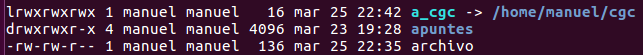

La primera columna del listado está formada por una secuencia de 10 caracteres. **El primer carácter indica el tipo de archivo**, mientras que los nueve siguientes representan sus permisos.

| Carácter | Tipo de archivo           |
| :------: | ------------------------- |
|   `-`    | Archivo regular           |
|   `d`    | Directorio                |
|   `l`    | Enlace simbólico          |
|   `c`    | Dispositivo de caracteres |
|   `b`    | Dispositivo de bloques    |
|   `p`    | Tubería con nombre (FIFO) |
|   `s`    | Socket                    |


#### Permisos

Un fichero o un directorio (nos vamos a centrar, de momento, en esos dos elementos y más adelante veremos los enlaces) pueden disponer de los tres permisos, de alguno de ellos, o, incluso, de ninguno.

Estos permisos tienen significado diferente en ficheros y directorios:

|  | Permisos sobre ficheros | Permisos sobre directorios |
| --- | --- | --- |
| r | Leer el contenido (cat) | Listar el contenido del directorio (ls) |
| w | Modificar el contenido (p.e. nano) | Añadir ficheros o directorios (p.e. cp, touch, etc.) |
| x | Ejecutar el fichero | Acceder al directorio (cd) |

**Nota:** Para crear, eliminar o cambiar el nombre de archivos y subdirectorios dentro de un directorio, normalmente se necesitan los permisos de escritura (`w`) y ejecución (`x`) sobre dicho directorio.

Si un fichero tiene el permiso de lectura, entonces podremos utilizar el comando cat para visualizar su contenido, si un directorio no tiene el permiso de ejecución, entonces no podremos entrar dentro de él empleando el comando cd.

Para indicar que no se posee un permiso se emplea el guión (-).

#### Tipos de usuario desde el punto de vista de los permisos

Desde el punto de vista de los permisos, existen tres tipos de usuario:

- Usuario propietario (u): es el usuario propietario de ese fichero o directorio. Cuando nosotros creamos un fichero o directorio, pasamos a ser los propietarios de esos objetos.

- Grupo propietario (g): es el grupo de usuarios propietario de ese fichero o directorio. Todo usuario pertenece como mínimo a un grupo y puede formar parte de varios grupos.

- Resto de usuarios (o): proviene del inglés others y hace referencia a todos los usuarios que no son ni el propietario ni aquellos que pertenecen al grupo propietario.

Como hemos dicho, los permisos son los nueve caracteres que aparecen después del indicador de tipo de archivo. Si los agrupamos en ternas (de tres en tres), entonces:

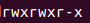

- La 1ª terna son los permisos que tiene el usuario propietario.

- La 2ª terna son los permisos que tiene el grupo propietario.

- La 3ª terna son los permisos que tiene el resto de usuarios.

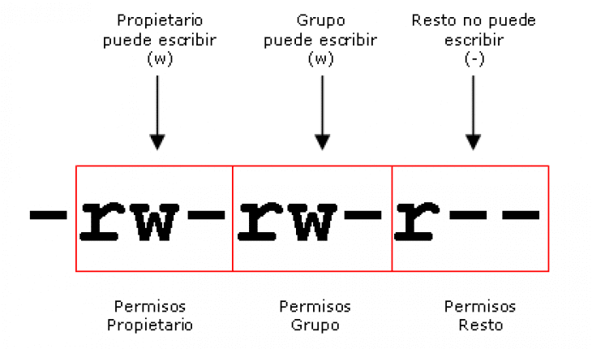

Dentro de cada terna, los permisos siempre ocupan la misma posición, primero se indica el permiso de lectura, después el permiso de escritura y por último el permiso de ejecución.

**Ejemplo 1**

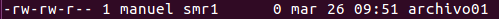

El fichero que se muestra en la imagen superior, archivo01, tiene como propietario al usuario manuel y como grupo propietario a smr1.

*El primer carácter de la línea es un guión, que significa que se trata de un fichero normal.*

Los tres siguientes caracteres: rw- hacen referencia a los permisos que tiene manuel, el **usuario propietario** del fichero, sobre ese fichero. El usuario tiene los permisos de lectura (r) y escritura (w) pero no tiene el de ejecución (-), que se indica con un guión. Esto significa que el usuario puede leer el contenido del fichero y también modificarlo. En el caso de que el fichero fuera un programa ejecutable, no podrían ejecutarlo.

Los tres siguientes caracteres: rw- hacen referencia a los permisos que tiene smr1, el **grupo propietario** del fichero, sobre ese fichero. Los miembros que pertenezcan a ese grupo tienen los permisos de lectura (r) y escritura (w) pero no tiene el de ejecución (-), que se indica con un guión. Esto significa que los usuarios miembros del grupo smr1 pueden leer el contenido del fichero y también modificarlo. En el caso de que el fichero fuera un programa ejecutable, no podrían ejecutarlo.

Los tres siguientes caracteres: r - - hacen referencia a los permisos que tienen sobre ese fichero el **resto de usuarios** que existen en el sistema y que no son, ni el propietario ni, los miembros del grupo propietario. El resto de usuarios tiene el permiso de lectura (r) pero no tiene los permisos de escritura ni ejecución, lo que significa que podrán leer el contenido del fichero pero no podrán modificarlo ni, en el caso de que fuera un programa ejecutable, tampoco podrían ejecutarlo.

**Ejemplo 2**

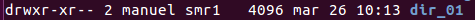

El directorio que se muestra en la imagen superior, dir_01, tiene como propietario al usuario manuel y como grupo propietario a smr1.

*El* primer carácter de la línea es la letra d, que significa que se trata de un directorio.

Los tres siguientes caracteres: rwx hacen referencia a los permisos que tiene manuel, el **usuario propietario** del directorio, sobre ese directorio. El usuario tiene los permisos de lectura (r), escritura (w) y ejecución (x). Esto significa que el usuario puede listar (r) el contenido del directorio, modificar (w) el contenido del directorio y entrar dentro de él (x).

Los tres siguientes caracteres: r-x hacen referencia a los permisos que tiene smr, el **grupo propietario** del directorio, sobre ese directorio. Los usuarios que pertenecen a ese grupo tienen los permisos de lectura (r) y ejecución (x), pero no tienen el permiso de escritura (-). Esto significa que el usuario puede listar (r) el contenido del directorio, entrar dentro del directorio (x), pero no pueden modificar su contenido, es decir, no pueden crear ficheros ni directorios ni eliminarlos (-).

Los tres siguientes caracteres: r - - hacen referencia a los permisos que tiene el resto de usuarios sobre ese directorio. El **resto de usuarios** tienen el permiso de lectura (r), pero no tienen los permisos de escritura (-) ni de ejecución (-). Esto significa que el resto de usuarios pueden listar (r) el contenido del directorio, pero no pueden modificar su contenido (-) ni entrar dentro de ese directorio (-).

**Observaciones**

Aunque en los ejemplos se menciona el primer carácter, el que indica que el tipo de elemento que es (fichero normal o directorio), este carácter no pertenece al grupo de permisos. Se utiliza para ayudar a indicar los caracteres que representan los permisos.

#### Ejecutar comandos con permiso de superusuario o root

El comando para modificar los permisos de archivos y directorios es `chmod`. **El propietario de un archivo puede modificar sus permisos sin utilizar `sudo`.** Para modificar los permisos de archivos pertenecientes a otros usuarios, se necesitan privilegios adecuados, por ejemplo mediante `sudo` cuando la cuenta esté autorizada.

En Ubuntu, los usuarios autorizados pueden ejecutar comandos administrativos anteponiendo `sudo`. Esto no es necesario para modificar los permisos de los archivos propios con `chmod`.

**Observaciones**

Para crear o modificar archivos en ubicaciones protegidas puede ser necesario utilizar privilegios administrativos. La necesidad de privilegios depende de los permisos efectivos y de la ubicación.

La forma de ejecutar un comando con permiso de root es anteponiendo el comando sudo.

**Sintaxis**

```bash
sudo <comando>
```

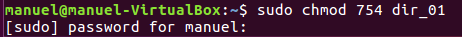

Cuando se ejecuta cualquier comando utilizando sudo, el sistema solicita la contraseña del usuario. Si, la contraseña la hemos introducido recientemente, el sistema no nos la volverá a pedir cuando ejecutemos otro comando con sudo.

#### Modificar los permisos de un fichero o directorio

Como ya hemos mencionado, el comando para modificar los permisos de los ficheros y directorios es chmod.

**Sintaxis**

```bash
chmod <opciones> <fichero1|directorio1> [<fichero2|directorio2> …]

<opciones>	se emplea para modificar los permisos.
<fichero1|directorio1>	fichero o directorio al que se le van a cambiar los permisos.
```

Existen dos formas de modificar los permisos de ficheros y directorios, de forma simbólica y de forma absoluta.

##### Forma relativa o simbólica

La forma simbólica permite cambiar algunos permisos sin alterar el resto, es decir, podemos añadir permiso de lectura a un fichero para el resto de usuarios directamente sin tener que reescribir el resto de permisos o quitar el permiso de ejecución (acceso) al grupo propietario sobre un directorio.

**Sintaxis**

```bash
chmod <opciones> <fichero1/directorio1> [<fichero2/directorio2> …]

<opciones>
<usuario><acción><permisos>[,<usuario2><acción2><permisos2>,<usuario3><acción3><permisos3>…]

Ejemplos:
chmod u=rw,g+w fichero
chmod o-r directorio

<usuario>
Para especificar el usuario al que vamos a modificar los permisos se emplean las letras u, g y o que significan, respectivamente, usuario propietario, grupo propietario y resto de usuarios.

<acción>
Las acciones pueden ser asignar permiso (=), añadir permiso (+) o eliminar permiso (-).

Cuando se emplea asignar permiso (=), los permisos sobre ese usuario solamente tendrán los permisos especificados. Por ejemplo, si el usuario propietario tiene los permisos rw- y se utiliza asignar permiso con r (u=r), los permisos quedarán de la siguiente forma, r--. Los permisos que no se han especificado y que estuvieran presentes serían eliminados.

Cuando se emplea añadir permiso (+), los permisos que se especifiquen sobre ese usuario, se añadirán sin eliminar los que ya tiene. Por ejemplo, si el grupo propietario tuviera solo permiso de lectura (r--) y le añadimos el permiso de escritura (g+w), los permisos para ese usuario (g) serán rw-. En este caso no se ha eliminado el permiso de lectura como en el caso anterior.

Cuando se emplea eliminar permiso (-), los permisos que se especifiquen sobre ese usuario serán eliminados. Por ejemplo, si el usuario otros (o) tiene los siguientes permisos rwx y se le desea quitar los permisos de escritura y ejecución, habría que indicarlo de la siguiente manera o-wx.

Para eliminar TODOS los permisos a un usuario, se puede hacer de dos maneras:
   <usuario>-rwx
   <usuario>=-
```


**Ejemplo 1**

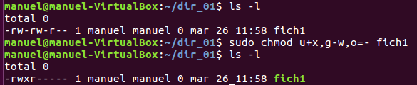

Como se muestra en la imagen, el fichero fich1 tiene los siguientes permisos:

- Usuario propietario (**u**): lectura (**r**) y escritura (**w**).

- Grupo propietario (**g**): lectura (**r**) y escritura (**w**).

- Resto de usuarios (**o**): lectura (**r)**.

La modificación de los permisos de este fichero son las siguientes:

- Usuario propietario (**u**): se le añade el permiso de ejecución (**u+x**).

- Grupo propietario (**g**): se le elimina el permiso de escritura **(g-w**).

- Resto de usuarios (**o**): se le elimina TODOS los permisos (**o=-**).

Los permisos resultantes son como se muestran en la última línea de la imagen:

- Usuario propietario (**u**): lectura (**r**), escritura (**w**) y ejecución (**x**).

- Grupo propietario (**g**): lectura (**r**).

- Resto de usuarios (**o**): ningún permiso.

**Ejemplo 2**

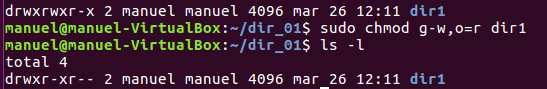

Como se muestra en la imagen, el directorio dir1 tiene los siguientes permisos:

- Usuario propietario (**u**): lectura (**r**), escritura (**w**) y ejecución (**x**).

- Grupo propietario (**g**): lectura (**r**), escritura (**w**) y ejecución (**x**).

- Resto de usuarios (**o**): lectura (**r**) y ejecución (**x**).

La modificación de los permisos de este fichero son las siguientes:

- Grupo propietario (**g**): se le elimina el permiso de escritura (**g-w**).

- Resto de usuarios (**o**): se le concede solamente el permiso de lectura (**o=r**).

Los permisos resultantes son como se muestran en la última línea de la imagen:

- Usuario propietario (**u**): lectura (**r**), escritura (**w**) y ejecución (**x**).

- Grupo propietario (**g**): lectura (**r**) y ejecución (**x**).

- Resto de usuarios (**o**): permiso de lectura (**r**).

##### Forma absoluta

La segunda forma de modificar los permisos, la absoluta, implica cambiar o sobreescribir TODOS los permisos de todos los usuarios. No se puede modificar solamente un permiso de un usuario o varios permisos de uno o dos usuarios, por lo que antes de proceder a la modificación de los permisos, es conveniente consultar antes como están los permisos con ls -l.

**Sintaxis**

```bash
chmod <opciones> <fichero1/directorio1> [<fichero2/directorio2> …]

<opciones>
Número octal (base 8) de tres dígitos.

Ejemplos
chmod 764 fich01
chmod 640 directorio1 directorio2
```

Como ya se ha mencionado, los permisos siempre se colocan en el mismo orden independientemente del usuario al que pertenezcan (rwx) y, de igual forma, los usuarios siempre se colocan en el mimo orden, es decir, primero se colocan los permisos del usuario propietario, después el del grupo propietario y, finalmente, los permisos del resto de usuarios.

| Usuario propietario | Grupo propietario | Resto de usuarios |
| --- | --- | --- |
| r w x | r w x | r w x |

Para indicar numéricamente que existe un permiso se coloca un 1 y si no existe se coloca en cero.

| Usuario propietario | Grupo propietario | Resto de usuarios |
| --- | --- | --- |
| r w x | r w x | r w x |
| r w x | r w - | r - - |
| 1 1 1 | 1 1 0 | 1 0 0 |

Se expresa en octal (base 8) los permisos de cada uno de los usuarios.

| Usuario propietario | Grupo propietario | Resto de usuarios |
| --- | --- | --- |
| r w x | r w x | r w x |
| r w x | r w - | r - - |
| 1 1 1 | 1 1 0 | 1 0 0 |
| 7 | 6 | 4 |

Para establecer estos permisos se ejecutaría el comando de la siguiente forma:

```bash
chmod 764 fichero1
```

**Ejemplo 1**

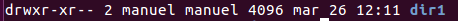

Como se indica en la imagen, el directorio dir1 tiene los siguientes permisos:

- Usuario propietario (**u**): lectura (**r**), escritura (**w**) y ejecución (**x**).

- Grupo propietario (**g**): lectura (**r**) y ejecución (**x**).

- Resto de usuarios (**o**): permiso de lectura (**r**).

Numéricamente está representado de la siguiente forma:

| Usuario propietario | Grupo propietario | Resto de usuarios |
| --- | --- | --- |
| r w x | r w x | r w X |
| 1 1 1 | 1 0 1 | 1 0 0 |

Si deseamos modificar los permisos de forma que:

- Usuario propietario (**u**): lectura (**r**) y escritura (**w**).

- Grupo propietario (**g**): lectura (**r**), escritura (**w**) y ejecución (**x**).

- Resto de usuarios (**o**): lectura (**r**) y ejecución (**x**).

Tendremos que calcular el número octal de tres dígitos correspondiente a los nuevos permisos:

| Usuario propietario | Grupo propietario | Resto de usuarios |
| --- | --- | --- |
| r w x | r w x | r w X |
| 1 1 0 | 1 1 1 | 1 0 1 |
| 6 | 7 | 5 |

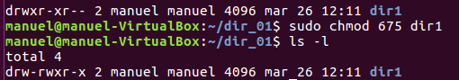

**Ejemplo 2**


Como se indica en la imagen, el fichero fich1 tiene los siguientes permisos:

- Usuario propietario (**u**): lectura (**r**), escritura (**w**) y ejecución (**x**).

- Grupo propietario (**g**): lectura (**r**), escritura (**w**) y ejecución (**x**).

- Resto de usuarios (**o**): lectura (**r**), escritura (**w**) y ejecución (**x**).

Numéricamente está representado de la siguiente forma:

| Usuario propietario | Grupo propietario | Resto de usuarios |
| --- | --- | --- |
| r w x | r w x | r w X |
| 1 | 1 | 1 |

Si deseamos modificar los permisos de forma que:

- Usuario propietario (**u**): lectura (**r**), escritura (**w**) y ejecución (**x**).

- Grupo propietario (**g**): lectura (**r**) y escritura (**w**).

- Resto de usuarios (**o**): ningún permiso.

Tendremos que calcular el número octal de tres dígitos correspondiente a los nuevos permisos:

| Usuario propietario | Grupo propietario | Resto de usuarios |
| --- | --- | --- |
| r w x | r w x | r w X |
| 1 1 1 | 1 1 0 | 0 0 0 |
| 7 | 6 | 0 |

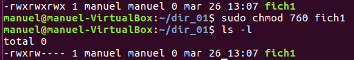

#### Cambio de propietario y de grupo de un archivo

Dos de los atributos de un archivo son su propietario y su grupo. Estos atributos pueden cambiarse mediante dos comandos:

##### Comando chown

`chown` permite cambiar el propietario del archivo o directorio, así como el grupo. Su utilización genérica es la siguiente:

```bash
chown nuevo_propietario archivo
```

##### Comando chgrp

`chgrp` permite cambiar el grupo al que pertenece un archivo. Su utilización genérica es esta:

```bash
chgrp nuevo_grupo archivo
```

**Cambio de grupo con chown**

Se puede cambiar el grupo al que pertenece un archivo utilizando chown de la siguiente forma:

```bash
chown :nuevo_grupo archivo
```


### 6.7.2. Gestión de permisos en Windows

En Windows, los permisos pueden clasificarse, según cómo se establecen, en dos tipos:

- **Permisos explícitos:** son aquellos que se asignan directamente a un archivo o carpeta por un usuario con permisos para administrarlos.
- **Permisos heredados:** son aquellos que un archivo o carpeta recibe de la carpeta que lo contiene. Esta, a su vez, puede haberlos heredado de otra carpeta de nivel superior. Por defecto, en Windows, los archivos y carpetas heredan los permisos de su carpeta contenedora, aunque este comportamiento puede modificarse.

**Observación:** En Windows, los permisos pueden establecerse para permitir o denegar determinadas operaciones.

#### 1 Listas de control de acceso

Las ACL (*Access Control List*) permiten definir los permisos que tienen los usuarios y grupos de usuarios sobre archivos y directorios. Cada archivo o directorio tendrá una ACL y esta, a su vez, contendrá un conjunto de “Entradas de control de acceso” o ACE. Cada ACE está compuesta por el par “usuario o grupo” y “permiso” de forma que si un usuario tiene permiso de lectura y acceso a un directorio, ese directorio tendrá 2 ACEs con el mismo nombre del usuario y cada una un permiso diferente.

Ejemplo de ACEs para el directorio c:\Docus

Grupo1/escritura, Grupo1/lectura, Usuario2/lectura y Grupo2/Control total

#### 2 Permisos sobre archivos

En los sistemas Windows los permisos básicos sobre los archivos son:

- **Lectura**: permite visualizar el contenido del archivo y ver sus atributos.
- **Escritura**: permite sobrescribir el archivo y cambiar sus atributos.
- **Lectura y ejecución**: permite leer los archivos y ejecutarlos (sirve para los archivos ejecutables).
- **Modificar**: permite modificar y borrar un archivo.
- **Control total**: permite hacer cualquier operación sobre el archivo, incluso cambiar su propietario y los permisos sobre este.

#### 3 Permisos sobre carpetas

Los permisos para archivos aplicados sobre las carpetas tienen un significado diferente:

- **Mostrar el contenido de la carpeta**: permite mostrar los archivos y subdirectorios que componen una carpeta.
- **Lectura**: permite mostrar los archivos y subdirectorios que componen una carpeta con sus atributos, propietario y permisos.
- **Escritura**: permite crear nuevos archivos y subcarpetas.
- **Lectura y ejecución**: permite entrar dentro de la carpeta y de sus subdirectorios. Además, permite lo mismo que el permiso Lectura.
- **Modificar**: permite borrar la carpeta además de lo que conceden los permisos Escribir, Leer y Mostrar el contenido de la carpeta.
- **Control total**: permite realizar cualquier operación sobre el directorio, incluso cambiar su propietario y los permisos sobre este. Control total sobre una carpeta permite además eliminar sus archivos independientemente de los permisos establecidos en estos.


> **Nota:** Windows dispone además de permisos avanzados o especiales que permiten afinar todavía más el acceso a archivos y carpetas (por ejemplo, cambiar permisos, tomar posesión o atravesar carpetas).  
> Estos permisos existen y pueden consultarse en las opciones avanzadas de seguridad, aunque en este módulo no se van a trabajar.


#### 4 Configuración de permisos mediante la interfaz gráfica 

La gestión de permisos en Windows se realiza de forma gráfica.

Para poder **ver y modificar los permisos** de un archivo o directorio se siguen estos pasos:

```
Archivo o carpeta → Botón derecho → Propiedades → Seguridad → Editar
```

Para acceder a la configuración avanzada de permisos y a la herencia:

```
Archivo o carpeta → Botón derecho → Propiedades → Seguridad → Opciones avanzadas
```

Por defecto, los archivos y carpetas **heredan los permisos del directorio superior que los contiene**.

Si se desea establecer permisos propios diferentes, es necesario deshabilitar la herencia de la siguiente forma. Acceder a:

```
Archivo o carpeta → Botón derecho → Propiedades → Seguridad → Opciones avanzadas

y deshabilitar la herencia.
```

