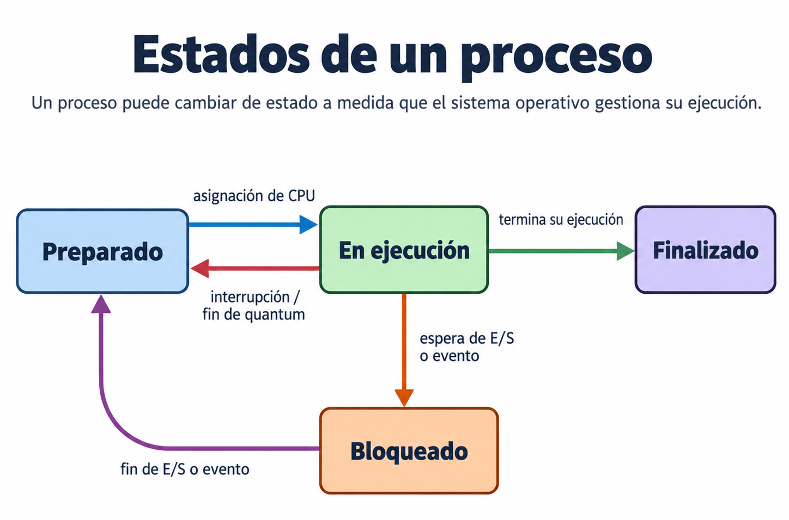

# UT6 Sistemas de archivos y procesos en Linux y Windows

## 6.8. Identificación de procesos y sus estados

Como vimos en la UT3, un **proceso** es un programa que se encuentra en ejecución. El sistema operativo se encarga de gestionar los procesos y controlar su ejecución.

Durante su ejecución, un proceso puede encontrarse en diferentes estados. Los más habituales son:

- **En ejecución**, cuando está utilizando el procesador.
- **Preparado**, cuando está listo para ejecutarse y espera a que el procesador quede disponible.
- **Bloqueado**, cuando está esperando a que se produzca algún evento, por ejemplo, la finalización de una operación de entrada y salida.
- **Finalizado**, cuando ha terminado su ejecución.



### 6.8.1. Identificación de procesos

Cada proceso tiene asignado un identificador denominado PID (Process Identifier), que permite distinguirlo de los demás procesos del sistema. Este identificador es único mientras el proceso existe, aunque puede reutilizarse después de su finalización.

Además, de forma general, podemos distinguir dos grandes tipos de procesos:

- **Procesos del sistema**: son los necesarios para el funcionamiento del sistema operativo y de sus servicios.
- **Procesos de usuario**: son los que se ejecutan a partir de las aplicaciones o programas iniciados por los usuarios.

Cuando identificamos un proceso, normalmente nos interesa conocer su **nombre**, su **PID** y, cuando sea posible, el **estado** en el que se encuentra.

### 6.8.2. Identificación de procesos en Linux

Linux dispone de herramientas gráficas y comandos de terminal que permiten identificar los procesos del sistema y consultar información sobre ellos, como su nombre, PID, usuario propietario, estado y consumo de recursos.

#### Identificación de procesos mediante el Monitor del sistema

En Ubuntu podemos utilizar la aplicación **Monitor del sistema** para consultar los procesos que se encuentran activos.

Esta herramienta muestra una lista de procesos y permite consultar información como:

- **Nombre:** identifica el proceso.
- **PID:** identificador del proceso.
- **Usuario:** usuario al que pertenece el proceso.
- **Estado:** situación en la que se encuentra el proceso.
- **CPU:** porcentaje de utilización del procesador.
- **Memoria:** cantidad de memoria RAM utilizada por el proceso.

El Monitor del sistema permite observar los procesos de forma gráfica y consultar cómo varía su consumo de recursos.

#### Identificación de procesos mediante comandos

Linux también permite consultar los procesos desde la terminal.

##### Comando ps

El comando `ps` (*process status*) permite mostrar información sobre los procesos existentes en el sistema.

**Sintaxis básica:**

```bash
ps
```

Sin opciones, muestra normalmente los procesos asociados a la terminal actual.

Para consultar los procesos de todos los usuarios y obtener información sobre su estado, podemos utilizar:

```bash
ps -eo pid,user,stat,comm
```

Este comando muestra las siguientes columnas:

| Columna   | Significado                                        |
| --------- | -------------------------------------------------- |
| `PID`     | Identificador del proceso.                         |
| `USER`    | Usuario propietario del proceso.                   |
| `STAT`    | Estado del proceso.                                |
| `COMMAND` | Nombre del programa o comando asociado al proceso. |

Los principales caracteres que pueden aparecer en la columna `STAT` son:

| Carácter | Estado                         | Significado                                                  |
| :------: | ------------------------------ | ------------------------------------------------------------ |
|   `R`    | En ejecución o preparado       | El proceso está utilizando la CPU o está preparado para utilizarla. |
|   `S`    | Dormido (espera interrumpible) | El proceso está esperando algún evento y puede ser despertado mediante una señal. |
|   `D`    | Espera no interrumpible        | El proceso está esperando, generalmente, una operación de entrada/salida. |
|   `T`    | Detenido                       | La ejecución del proceso se ha detenido temporalmente.       |
|   `Z`    | Zombi                          | El proceso ha terminado, pero todavía conserva una entrada en la tabla de procesos hasta que se recoge su estado de finalización. |

**Observación:** Los estados que muestra Linux no coinciden exactamente con los estados teóricos estudiados anteriormente. Por ejemplo, `R` agrupa los estados preparado y en ejecución, mientras que `S` y `D` representan diferentes situaciones de espera o bloqueo.

Además, en la columna `STAT` pueden aparecer otros caracteres que proporcionan información adicional sobre el proceso.

##### Comando top

El comando `top` permite visualizar los procesos del sistema de forma dinámica, actualizando periódicamente la información.

**Sintaxis:**

```bash
top
```

Entre los datos que muestra se encuentran:

- PID del proceso.
- Usuario propietario.
- Estado del proceso.
- Porcentaje de utilización de la CPU.
- Porcentaje y cantidad de memoria utilizada.
- Nombre del proceso.

A diferencia de `ps`, que muestra la información correspondiente al momento en el que se ejecuta, `top` actualiza los datos periódicamente, lo que permite observar la actividad de los procesos.

Para salir de `top`, se pulsa la tecla `q`.

**Observación:** En `top`, la columna `S` indica el estado del proceso mediante caracteres similares a los utilizados por `ps`.

### 6.8.3. Identificación de procesos en Windows

Windows dispone de herramientas gráficas y comandos que permiten identificar los procesos del sistema y consultar información sobre ellos, como su nombre, PID, usuario propietario, estado y consumo de recursos.

#### Identificación de procesos mediante el Administrador de tareas

El **Administrador de tareas** es una herramienta de Windows que permite visualizar los procesos que se encuentran activos en el sistema.

Podemos abrirlo mediante la combinación de teclas **Ctrl + Mayús + Esc**.

Dentro del Administrador de tareas, podemos utilizar principalmente dos apartados:

- **Procesos:** muestra las aplicaciones y los procesos en segundo plano, junto con información sobre el consumo de CPU, memoria, disco y otros recursos.
- **Detalles:** ofrece una lista más detallada de los procesos, permitiendo consultar su nombre, PID, estado y otros datos.

Para identificar los procesos y sus estados resulta especialmente útil el apartado **Detalles**, donde podemos consultar las siguientes columnas:

| Columna           | Significado                                        |
| ----------------- | -------------------------------------------------- |
| Nombre            | Nombre del archivo ejecutable asociado al proceso. |
| PID               | Identificador del proceso.                         |
| Estado            | Estado en el que se encuentra el proceso.          |
| Nombre de usuario | Usuario al que pertenece el proceso.               |
| CPU               | Utilización del procesador por parte del proceso.  |
| Memoria           | Cantidad de memoria utilizada por el proceso.      |

**Observación:** Algunas columnas pueden no estar visibles inicialmente. Para mostrarlas, podemos hacer clic con el botón derecho sobre los encabezados de las columnas y seleccionar las que deseamos visualizar.

Los principales estados que podemos encontrar son:

- **En ejecución:** el proceso se encuentra activo y puede ejecutar instrucciones o estar esperando recursos.
- **Suspendido:** la ejecución del proceso se ha suspendido temporalmente.

**Observación:** El estado «En ejecución» que muestra el Administrador de tareas no significa necesariamente que el proceso esté utilizando la CPU en ese instante. Puede encontrarse esperando mientras continúa activo. Por tanto, no debe confundirse directamente con el estado teórico «En ejecución» estudiado anteriormente.

#### Identificación de procesos mediante comandos

Windows también permite consultar los procesos desde la línea de comandos.

##### Comando tasklist

El comando `tasklist` permite mostrar una lista de los procesos que se encuentran activos en el sistema.

**Sintaxis básica:**

```cmd
tasklist
```

El resultado muestra información como:

| Columna          | Significado                                        |
| ---------------- | -------------------------------------------------- |
| Nombre de imagen | Nombre del archivo ejecutable asociado al proceso. |
| PID              | Identificador del proceso.                         |
| Nombre de sesión | Sesión a la que pertenece el proceso.              |
| Núm. de sesión   | Identificador de la sesión.                        |
| Uso de memoria   | Cantidad de memoria utilizada por el proceso.      |

Para obtener información adicional sobre los procesos, podemos utilizar la opción `/v`:

```cmd
tasklist /v
```

Esta opción muestra información más detallada, como el usuario asociado al proceso y su estado.

**Observación:** `tasklist` no muestra los estados internos de planificación del sistema operativo, como preparado o bloqueado. La información de estado que proporciona, especialmente con `/v`, es más limitada y no equivale directamente a los estados teóricos estudiados anteriormente.